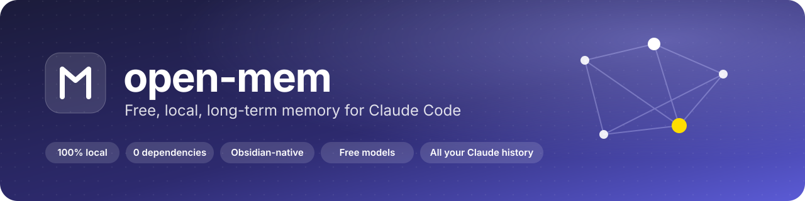
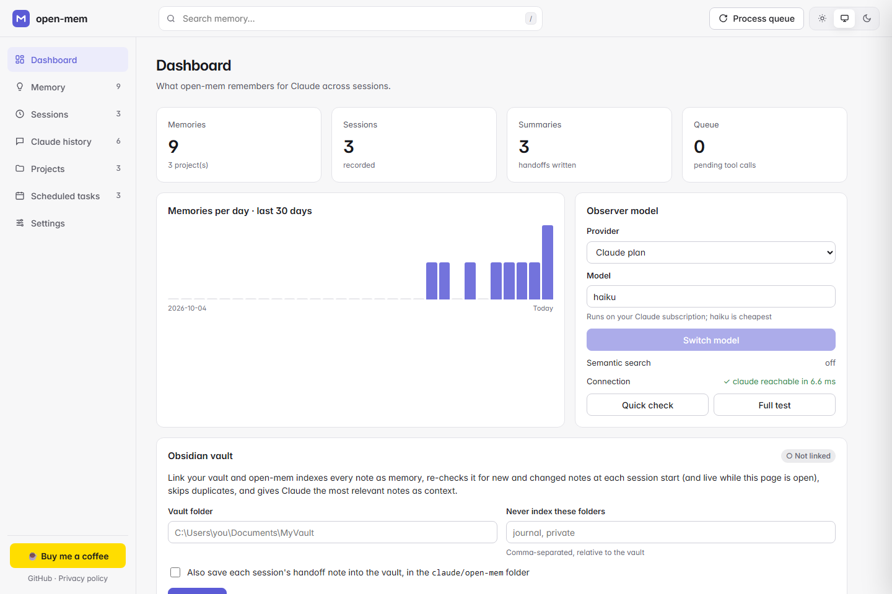
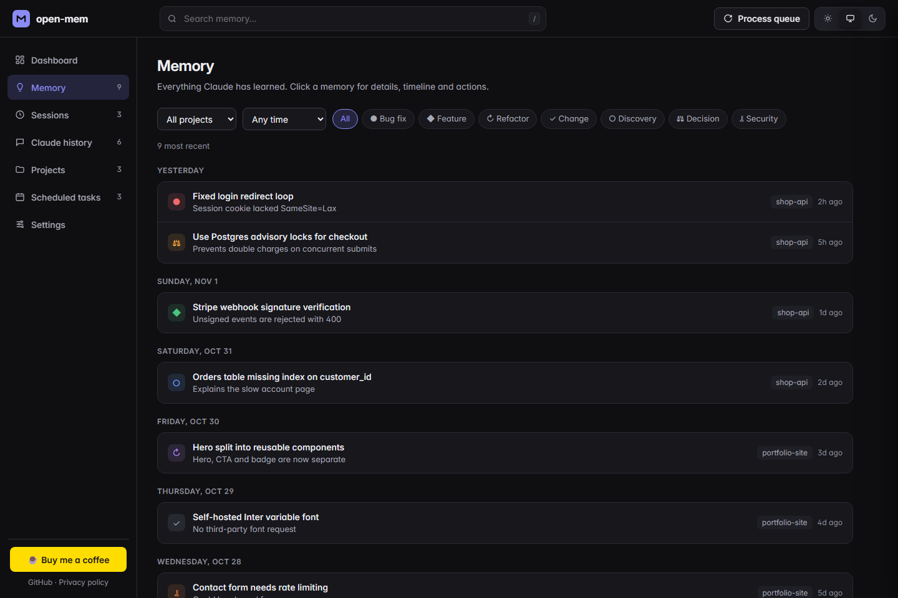
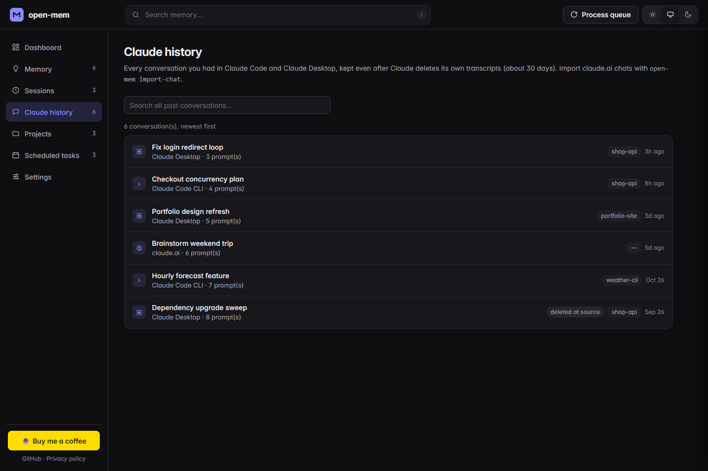
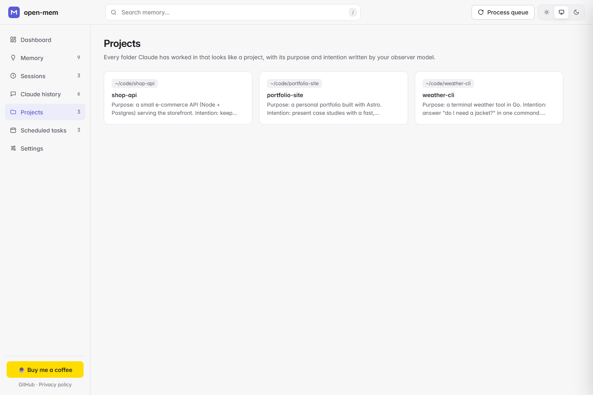
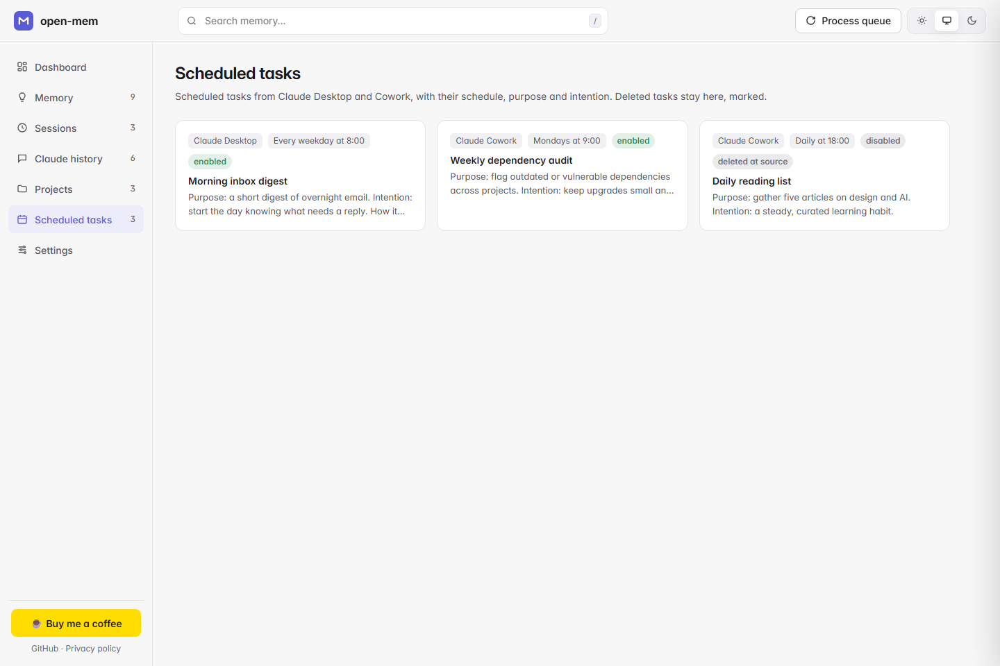
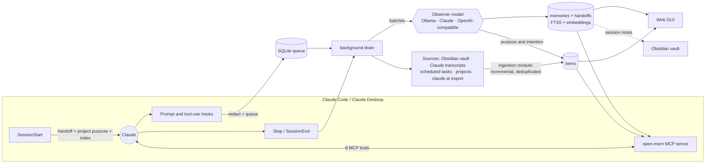

<p align="center">
  
</p>

<p align="center">
  <b>Claude remembers what you built, fixed and decided, across every session, without a subscription, an account or a cloud.</b>
</p>

<p align="center">
  <a href="LICENSE"></a>
  
  
  
  
  
</p>

<p align="center">
  <a href="#-install">Install</a> ·
  <a href="#-setup">Setup</a> ·
  <a href="#-using-open-mem">Usage</a> ·
  <a href="#-features">Features</a> ·
  <a href="#-how-it-works">How it works</a> ·
  <a href="#-privacy">Privacy</a> ·
  <a href="#-faq">FAQ</a>
</p>

<br>

<picture>
  <source media="(prefers-color-scheme: dark)" srcset="assets/dashboard-dark.png">
  
</picture>

<p align="center"><sub>The open-mem dashboard (all data shown is a fictional demo).</sub></p>

---

## ✨ Why open-mem

Every Claude Code session starts from a blank page. You explain the project again, re-discover the same gotchas and lose last week's decisions. **open-mem gives Claude a long-term memory** that runs entirely on your computer:

- 🧠 **It remembers on its own.** While you work, it captures what Claude does and compresses it into short, searchable memories, with no extra steps from you.
- 🔁 **It hands off.** When a session ends, it writes a summary (what was asked, done, learned, and what's next), and the next session starts with it.
- 🕰️ **It knows your history.** Every past Claude Code and Claude Desktop conversation, every project and every scheduled task become memory, even after Claude deletes its own transcripts.
- 🗂️ **It lives in your second brain.** Link your Obsidian vault: open-mem indexes every note for Claude, and writes session notes back into the vault.
- 🔒 **It stays yours.** Everything is stored locally. The only thing that ever leaves your machine is what goes to the model *you* choose, and with Ollama that's nothing at all.

> open-mem is inspired by the excellent open-source [claude-mem](https://github.com/thedotmack/claude-mem). It is an independent, much smaller reimplementation (zero npm dependencies) built to run on free, local models. It is not affiliated with claude-mem or Anthropic.

---

## 🚀 Features

<table>
<tr>
<td width="50%" valign="top">

### 🧠 Automatic memory
Claude Code hooks record prompts, edits, commands and findings. An **observer model** turns them into typed memories: `bugfix`, `feature`, `decision`, `discovery`, `refactor`, `change`, `security_note`. Each has a title, facts, a narrative and the files involved.

### 🔁 Session handoffs
After each session, a short handoff (*request · completed · learned · next steps*) is written and **injected automatically** when you next start Claude in that project.

### 🔍 Hybrid search
SQLite **FTS5** keyword ranking fused with **semantic** embedding similarity (reciprocal rank fusion). It finds "the cookie thing" even when you've forgotten the exact words.

### 🪜 Token-cheap recall
Claude searches with a **3-step progressive disclosure** flow (`search` → `timeline` → `get_observations`), fetching full details only for the memories that matter. That's about 10× fewer tokens than dumping everything.

</td>
<td width="50%" valign="top">

### 🕰️ All your Claude history
Every **Claude Code CLI** and **Claude Desktop** conversation is archived from Claude's own transcripts, and kept even after Claude cleans them up (about 30 days). **claude.ai** chats import from the official export. Background runs are filtered out automatically.

### 📁 Projects and scheduled tasks
A living registry of **every project Claude has worked in** and **every scheduled task** in Claude Desktop and Cowork. Each gets a **purpose and intention** written by your observer model, and the project's purpose is injected when you work there.

### 🗂️ Obsidian, both ways
**Link your vault** and every note is indexed as memory. It's kept current by a live watcher, duplicate copies are stored once, and private folders can be excluded. Session handoffs can be **written back** as linked notes with a per-project index.

### 🛡️ Private by design
Secrets (API keys, tokens, passwords, JWTs, private keys, URL credentials) are **redacted before anything is stored or sent**. `<private>…</private>` keeps text out entirely. No telemetry, no account.

</td>
</tr>
<tr>
<td valign="top">

### 🆓 Free models, your choice
**Ollama** (free, offline), your **Claude plan** (`claude -p`), or any **OpenAI-compatible** API (OpenRouter, Gemini, Groq, LM Studio…). Switch with one click.

</td>
<td valign="top">

### ⚡ Never slows Claude down
Hooks only write to SQLite (milliseconds). Model calls run in a **detached background process**, and syncing your history checks only what changed (under a second).

</td>
</tr>
</table>

### 🖥️ A web GUI you'll actually use

| | |
|:--:|:--:|
|  |  |
| **Memory**: search, filter by project, type and time, then open any memory for its timeline | **Claude history**: every past conversation, searchable, across all surfaces |
|  |  |
| **Projects**: everything you've built, with purpose and intention | **Scheduled tasks**: schedule, status and purpose, including deleted ones |

Light and dark themes, keyboard shortcuts (<kbd>/</kbd> to search, <kbd>Esc</kbd> to close), WCAG AA contrast, and a layout that works down to phone width.

---

## 📦 Install

**You need:** [Claude Code](https://claude.com/claude-code) (CLI or the Claude Desktop Code tab) and [Node.js](https://nodejs.org) **22.13 or newer**.

**1. Add the plugin.** Inside Claude Code:

```
/plugin marketplace add kamalivaturi/open-mem
/plugin install open-mem@open-mem
```

Or from a terminal:

```bash
claude plugin marketplace add kamalivaturi/open-mem
```

```bash
claude plugin install open-mem@open-mem
```

**2. Restart Claude Code.** That's the whole install: hooks and the MCP server are registered by the plugin.

**3. Open the dashboard** (optional, but it's the easiest way to finish setup):

```bash
npx -y github:kamalivaturi/open-mem viewer
```

Then visit <http://127.0.0.1:37778>.

---

## 🛠 Setup

Setup takes about two minutes, all from the dashboard.

### 1. Choose the observer model

The observer writes memories, handoffs and project purposes. Pick it in **Dashboard → Observer model**, then press **Quick check** (milliseconds) or **Full test** (a real reply).

| Option | Cost | Best for | Setup |
|---|---|---|---|
| 🦙 **Ollama** (default) | Free, offline | Privacy, no limits | Install [Ollama](https://ollama.com), then `ollama pull qwen2.5:7b` |
| ✳️ **Claude plan** | Uses your plan's usage | Best quality, zero setup | Pick *Claude plan* · model `haiku` |
| 🌐 **OpenAI-compatible** | Free tiers available | No local GPU | Pick it, set the API URL + key in **Settings** |

For **semantic search** (recommended), also run `ollama pull nomic-embed-text`. Without it, search is keyword-only.

### 2. Link your Obsidian vault (optional)

**Dashboard → Obsidian vault**: paste your vault folder → **Link vault**.

- Every note is indexed right away, and changes are picked up at each session start and live while the dashboard is open.
- **Never index these folders** keeps private folders (for example `journal, private`) out of memory.
- Tick **Also save each session's handoff note** to get one note per session in `claude/open-mem/`, linked from a per-project index note. It works with graph view, Dataview and Bases.

### 3. Your Claude history (automatic)

Nothing to do: at the next session start, open-mem records your past **Claude Code** and **Claude Desktop** conversations, your **projects** and your **scheduled tasks**. To bring in **claude.ai** chats, export your data from claude.ai (*Settings → Privacy → Export data*), unzip it, and run:

```bash
npx -y github:kamalivaturi/open-mem import-chat path/to/conversations.json
```

Each source can be switched off in **Settings** (`recordClaudeHistory`, `recordScheduledTasks`, `recordProjects`).

---

## 💬 Using open-mem

### In Claude

It's automatic. Start Claude in a project and the first message already carries:

```text
# open-mem: memory from earlier sessions in "shop-api"
## About this project
Purpose: a small e-commerce API (Node + Postgres) serving the storefront…
## Session 2026-11-02 14:03
Request: Fix the login loop and harden checkout
Completed: Cookie fix shipped; checkout uses advisory locks
Next steps: Add an e2e test for concurrent checkout
## Recent observations (newest first)
#42 2026-11-02 14:03 ● bugfix: Fixed login redirect loop
…
```

Claude can also dig deeper with these **MCP tools**. Just ask in plain words ("what did we decide about checkout locking?").

| Tool | What it does |
|---|---|
| `search` | Find memories (keyword + semantic), filtered by project, type or recency |
| `timeline` | What happened around a memory: neighbouring memories, prompts and handoffs |
| `get_observations` | Full details for chosen memories |
| `save_memory` | Explicitly remember a decision or preference ("remember that I prefer pnpm") |
| `past_sessions` | Search or open any past Claude conversation (CLI, Desktop, claude.ai) |
| `projects` | Every project with purpose and intention, or one in detail |
| `scheduled_tasks` | Every scheduled task with schedule, purpose and prompt |
| `vault_search` | Search your linked Obsidian vault |

### In the browser

`npx -y github:kamalivaturi/open-mem viewer` gives you the dashboard, Memory, Sessions (handoffs), Claude history, Projects, Scheduled tasks and Settings, as shown above.

### From the terminal

```text
open-mem viewer [--port 37778]                   web GUI
open-mem search <query> [--project p] [--type t] search memories
open-mem status                                  counts, queue and configuration
open-mem drain                                   process the queue and sync every source now
open-mem sync                                    record Claude history, tasks, projects and the vault
open-mem import-chat <conversations.json>        import claude.ai chats
open-mem ingest-vault [--dir v] [--watch]        index an Obsidian vault (and keep watching)
open-mem export-obsidian [--dir d]               write all session notes to Obsidian
```

Run any of them with `npx -y github:kamalivaturi/open-mem <command>`.

---

## ⚙️ Configuration

Everything is in `~/.open-mem/settings.json` (created on first run, editable in **Settings**). Set `OPEN_MEM_HOME` to move all data.

<details>
<summary><b>All settings</b></summary>

| Key | Default | Meaning |
|---|---|---|
| `provider` | `ollama` | Observer: `ollama`, `claude` or `openai` |
| `model` | `qwen2.5:7b` | Model for Ollama / OpenAI-compatible |
| `claudeModel` | `haiku` | Model for the `claude` provider |
| `ollamaUrl` | `http://127.0.0.1:11434` | Ollama server (also used for embeddings) |
| `openaiBaseUrl` / `openaiApiKey` | OpenRouter / empty | OpenAI-compatible endpoint (`OPEN_MEM_API_KEY` overrides the key) |
| `embedModel` | `nomic-embed-text` | Embedding model; `null` = keyword search only |
| `language` | `English` | Language memories are written in |
| `batchSize` | `8` | Tool calls per observer request |
| `contextObservations` / `contextSummaries` / `contextNotes` | `25` / `1` / `5` | What's injected at session start (`0` turns one off) |
| `skipTools` | Todo/Task tools | Tools never recorded; `prefix*` supported |
| `vaultDir` / `vaultExclude` | `null` / `[]` | Linked Obsidian vault and folders never indexed |
| `obsidianDir` | `null` | Where session notes are written |
| `recordClaudeHistory` / `recordScheduledTasks` / `recordProjects` | `true` | Archive Claude sessions, tasks and projects |
| `projectIgnoreTemp` | `true` | Never treat temp or scratch folders as projects |
| `claudeHome` / `claudeAppData` | auto | Override where Claude's files are found |
| `viewerPort` | `37778` | Web GUI port |

</details>

---

## 🔍 How it works



1. **Capture.** Hooks write prompts and tool calls (redacted) to a local SQLite queue in milliseconds.
2. **Compress.** A background drain sends batches to your observer model, which returns typed memories, deduplicated by title and embedding similarity.
3. **Hand off.** When a session stops, the observer writes the handoff, but only if new memories were made.
4. **Ingest.** One ingestion module keeps every **source** in sync: unchanged items are skipped by version stamp, changed ones re-parsed only if their content hash changed, duplicates stored once. Archive sources (Claude history, tasks) keep items that vanish upstream; the vault is mirrored.
5. **Recall.** At session start, the handoff, project purpose, memory index and related notes are injected; MCP tools fetch the rest on demand.

<details>
<summary><b>Code map</b></summary>

| File | Role |
|---|---|
| `src/hooks.mjs` | Claude Code hook handler; builds the session-start context |
| `src/observer.mjs` | Drain: batches → memories → dedup → handoffs → purposes → Obsidian notes |
| `src/ingest.mjs` | Ingestion module: change detection, dedup, archive/mirror, embeddings, watching, recall over items |
| `src/sources.mjs` | Source adapters: Obsidian vault, Claude transcripts, scheduled tasks, projects, claude.ai export |
| `src/llm.mjs` | Ollama, `claude -p` and OpenAI-compatible providers; embeddings |
| `src/db.mjs` | SQLite schema, FTS5, hybrid ranking, settings |
| `src/redact.mjs` | Secret redaction |
| `src/mcp.mjs` | MCP stdio server (JSON-RPC 2.0) |
| `src/viewer.mjs` · `src/viewer.html` | Local web GUI and JSON API |
| `bin/open-mem.mjs` | CLI entry point |

The domain language (Session, Observation, Handoff, Source, Item…) is defined in [CONTEXT.md](CONTEXT.md).

</details>

---

## 🔒 Privacy

open-mem is local-first by design. The full policy is in **[PRIVACY.md](PRIVACY.md)**; here is what it says.

| | |
|---|---|
| 🏠 **Where your data lives** | One folder on your machine: `~/.open-mem` (a SQLite database, your settings, a log). No servers, no account, no telemetry, no analytics. |
| 📤 **What leaves your machine** | Only what goes to the observer model you choose: redacted tool calls and prompts to write memories and handoffs, plus a project's README / CLAUDE.md excerpt or a task's prompt to write its purpose. **With Ollama, nothing leaves your computer.** Your recorded Claude history is never sent anywhere. |
| 📖 **What it reads** | Claude's own local files (transcripts, Desktop session titles, scheduled tasks), project READMEs, and your vault if you link it. All read-only: open-mem never changes or deletes them. |
| 🧹 **What it never keeps** | Claude's hidden reasoning, raw tool output from your history, subagent chatter, the text of automated background runs, and anything matching secret patterns. |
| 🛡️ **The web GUI** | Listens on `127.0.0.1` only, blocks foreign hosts (DNS rebinding) and cross-site writes, never returns your API key, and loads no third-party fonts or scripts. |
| 🎛️ **Your control** | Delete any memory in the GUI; switch any source off; exclude vault folders; wrap text in `<private>…</private>`; pause with `OPEN_MEM_DISABLE=1`; or delete `~/.open-mem` to erase everything. |

---

## 🩺 Troubleshooting

<details>
<summary><b>Nothing is being remembered</b></summary>

Run `npx -y github:kamalivaturi/open-mem status`. If **queue** keeps growing, the observer can't be reached: open the dashboard and press **Quick check**. A red "model not installed" means `ollama pull <model>`; otherwise switch provider. Errors are logged in `~/.open-mem/open-mem.log`.
</details>

<details>
<summary><b>"settings.json is invalid" banner</b></summary>

The file has a typo (often a trailing comma). open-mem uses safe defaults until you fix it or save from **Settings**, which rewrites it cleanly.
</details>

<details>
<summary><b>Hooks don't run</b></summary>

Make sure `node --version` is 22.13 or newer in the shell Claude Code starts from, then restart Claude Code. `claude plugin list` should show `open-mem`.
</details>

<details>
<summary><b>Search only finds exact words</b></summary>

Semantic search needs the embedding model: `ollama pull nomic-embed-text`. The dashboard's Quick check shows whether embeddings are available.
</details>

---

## ❓ FAQ

<details>
<summary><b>How is this different from claude-mem?</b></summary>

claude-mem is a large, feature-rich, open-source project with paid hosted extras. open-mem is a small, independent take focused on running fully locally with free models, plus Obsidian integration, all-surface Claude history, and project/task registries.
</details>

<details>
<summary><b>Does it slow Claude down?</b></summary>

No. Hooks take milliseconds; all model work happens in a background process. Syncing history at session start checks only what changed.
</details>

<details>
<summary><b>What does it cost?</b></summary>

Nothing with Ollama. With the Claude plan provider, each memory batch, handoff and purpose is one small Haiku call on your subscription.
</details>

<details>
<summary><b>Can I record Claude Cowork conversations?</b></summary>

Cowork's scheduled tasks are recorded. Cowork conversations aren't stored on your computer by Claude today, so there's nothing local to read; they'll be added if that changes.
</details>

<details>
<summary><b>How do I remove everything?</b></summary>

`claude plugin uninstall open-mem@open-mem`, then delete the `~/.open-mem` folder (and the `claude/open-mem` folder in your vault if you enabled session notes).
</details>

---

## 🗺 Roadmap

- 📄 **File-aware recall:** when Claude opens a file, surface past memories about it
- 🎯 **Relevance-ranked start context** from the current branch, files and prompt
- 🧩 **Memory consolidation:** merge related memories into durable knowledge notes
- ⚡ **ANN vector index** (`sqlite-vec`) for very large memory stores
- 🔁 **Retry budget and dead-letter queue** for batches a model can't handle
- 🤝 **More harnesses:** Codex CLI, Gemini CLI, Cursor, OpenCode
- 💬 **Cowork conversations**, once Claude stores them locally
- 🔐 **Encryption at rest** and optional git-backed sync of session notes

Ideas and pull requests are welcome in [Issues](https://github.com/kamalivaturi/open-mem/issues).

---

## 🧪 Development

```bash
git clone https://github.com/kamalivaturi/open-mem
```

```bash
cd open-mem && npm test
```

No install step: open-mem uses only Node's built-ins (`node:sqlite`, `node:http`, `node:test`). The tests use a fake model and temporary folders, so they never read your real data. They cover redaction, parsing, the full hook → memory → search → Obsidian flow, every source adapter, the MCP protocol and the GUI's security checks.

To try a local checkout as a plugin: `claude plugin marketplace add ./open-mem`, then `claude plugin install open-mem@open-mem`.

---

## 📄 License

[Apache-2.0](LICENSE) © Kamal Ivaturi. The bundled [Inter](https://rsms.me/inter/) font is © The Inter Project Authors, under the [SIL Open Font License](fonts/LICENSE-Inter.txt).

---

<p align="center">
  If open-mem saves you time (or a subscription), you can support its development:<br><br>
  <a href="https://buymeacoffee.com/kamalivaturi"></a>
</p>
