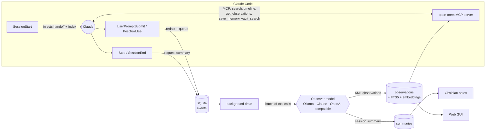

<div align="center">

# open-mem

**Free, local, long-term memory for Claude Code.**
Claude remembers what you built, fixed and decided last time, without a subscription, an account or a cloud.

[](LICENSE)


<a href="https://buymeacoffee.com/kamalivaturi"></a>

</div>

---

## What it does

Every Claude Code session normally starts from zero. open-mem fixes that:

1. **Captures** what Claude does (prompts, edits, commands, findings) through Claude Code hooks.
2. **Compresses** it into short, typed, searchable memories (`bugfix`, `feature`, `decision`, `discovery`…) using a model *you* choose: a free local Ollama model, your existing Claude plan, or any OpenAI-compatible API.
3. **Brings it back**: every new session starts with the last session's handoff (what was done, what's next) and an index of recent memories. Claude can dig deeper with MCP search tools.
4. **Connects to Obsidian**: session notes land in your vault as linked markdown, and Claude can search your vault notes too.

It is inspired by the excellent [claude-mem](https://github.com/thedotmack/claude-mem). claude-mem is open source, but its hosted observer and cloud features are paid. open-mem is an independent, much smaller reimplementation (~1,500 lines, zero npm dependencies) built to run entirely on your machine with free models. It is not affiliated with claude-mem or Anthropic.

## Features

| | |
|---|---|
| 🧠 **Automatic memory** | Hooks record every session; nothing to remember to do. |
| 🔁 **Session handoffs** | Each session ends with a summary: request, completed, learned, next steps. The next session starts with it. |
| 🔍 **Hybrid search** | SQLite FTS5 keyword ranking fused with local embedding similarity (reciprocal rank fusion). |
| 🪜 **Progressive disclosure** | MCP tools `search` → `timeline` → `get_observations` fetch full details only for the ids that matter (about 10× fewer tokens). |
| 🆓 **Pluggable, free models** | Ollama (offline), your Claude plan (`claude -p`), or OpenRouter / Gemini / Groq / LM Studio. |
| 🕰️ **All your Claude history** | Every Claude Code CLI and Claude Desktop session is archived from Claude's own transcripts, even after Claude deletes them (~30 days); claude.ai chats import from the official export. Background runs are filtered out. |
| 📁 **Projects and scheduled tasks** | A registry of every project Claude has worked in and every scheduled task in Claude Desktop and Cowork, each with a "purpose and intention" written by your observer model and injected when you work there. |
| 🗂️ **Obsidian, both ways** | Writes one note per session plus a per-project index with `[[wikilinks]]`; the `vault_search` tool lets Claude read your vault. |
| 🛡️ **Secret redaction** | API keys, tokens, passwords, JWTs, private keys and URL credentials are stripped *before* anything is stored or sent. `<private>…</private>` keeps text out entirely. |
| ♻️ **Deduplication** | Repeated findings are dropped by title and embedding similarity. |
| 🖥️ **Web GUI** | Dashboard, search with filters, timelines, session handoffs, settings, light and dark modes. |
| ⚡ **Never blocks Claude** | Hooks only write to SQLite (milliseconds); model calls run in a detached background process. |
| 📦 **Zero dependencies** | Pure Node.js 22+: built-in `node:sqlite`, `node:http` and a hand-written MCP server. |

## Install

**Requirements:** [Claude Code](https://claude.com/claude-code) and [Node.js](https://nodejs.org) 22.13 or newer.

Inside Claude Code:

```
/plugin marketplace add kamalivaturi/open-mem
/plugin install open-mem@open-mem
```

or from a terminal:

```bash
claude plugin marketplace add kamalivaturi/open-mem
claude plugin install open-mem@open-mem
```

Restart Claude Code. That's it: memories start with your next session.

### Pick an observer model (one time)

open-mem defaults to **Ollama** (free and offline). Install [Ollama](https://ollama.com), then:

```bash
ollama pull qwen2.5:7b
```

```bash
ollama pull nomic-embed-text
```

Prefer something else? Open the web GUI → **Settings**, or edit `~/.open-mem/settings.json`:

| Provider | Setting | Cost |
|---|---|---|
| Ollama | `"provider": "ollama", "model": "qwen2.5:7b"` | Free, offline |
| Your Claude plan | `"provider": "claude", "claudeModel": "haiku"` | Uses your plan's usage |
| OpenAI-compatible | `"provider": "openai", "openaiBaseUrl": "https://openrouter.ai/api/v1", "model": "<a :free model>"` + `OPEN_MEM_API_KEY` | Free tiers available |

Semantic search uses Ollama embeddings (`nomic-embed-text`) whatever the observer is. Without it, search falls back to keyword-only.

## Web GUI

```bash
npx -y github:kamalivaturi/open-mem viewer
```

Then open <http://127.0.0.1:37778>. It covers the dashboard and health check, search, memory details with timelines, session handoffs, and settings with a connection test. It follows your system theme, or you can pick light or dark.

> The GUI listens on `127.0.0.1` only, rejects other Host headers (DNS-rebinding protection) and requires a custom header for every change, so other websites can't read or modify your memory.

## Obsidian

Set these in **Settings → Obsidian** (or `settings.json`):

```json
{
  "obsidianDir": "C:\\Vault\\claude\\open-mem",
  "vaultDir": "C:\\Vault"
}
```

- `obsidianDir`: each summarized session becomes `<project>/<date> <id>.md` with frontmatter (`date`, `project`, `session`, `tags: [open-mem]`) and links to a `<project>.md` index note, ready for graph view, Dataview and Bases.
- `vaultDir`: enables the `vault_search` MCP tool so Claude can look things up in your notes (read-only).
- Back-fill old sessions: `npx -y github:kamalivaturi/open-mem export-obsidian`.

## How it works



| File | Role |
|---|---|
| `src/hooks.mjs` | Claude Code hook handler: records prompts and tool calls, renders start-of-session context |
| `src/ingest.mjs` | Ingestion: change detection, dedup, archive/mirror handling, embeddings and watching for any Source; recall over ingested items |
| `src/sources.mjs` | Source adapters: Obsidian vault, Claude transcripts, scheduled tasks, projects, claude.ai export |
| `src/observer.mjs` | Background pipeline: batches → observations → dedup → summaries → Obsidian |
| `src/llm.mjs` | Ollama, `claude -p` and OpenAI-compatible providers, plus embeddings |
| `src/db.mjs` | SQLite schema, FTS5 triggers, hybrid search, timeline |
| `src/redact.mjs` | Secret redaction and clipping |
| `src/mcp.mjs` | MCP stdio server (JSON-RPC 2.0) |
| `src/viewer.mjs`, `src/viewer.html` | Local web GUI and JSON API |
| `bin/open-mem.mjs` | CLI entry point |

### MCP tools

| Tool | Use |
|---|---|
| `search` | Compact index of matching memories (filters: project, type, days) |
| `timeline` | Memories, prompts and summaries around one memory |
| `get_observations` | Full details for chosen ids |
| `save_memory` | Explicitly remember a decision or preference |
| `vault_search` | Search your Obsidian vault (when `vaultDir` is set) |
| `past_sessions` | Search or open any recorded Claude conversation (CLI, Desktop, claude.ai) |
| `projects` | All projects with purpose and intention, or one project in detail |
| `scheduled_tasks` | All scheduled tasks with schedule, purpose and prompt |

## CLI

```
open-mem viewer [--port 37778]       web GUI
open-mem search <query> [--project p] [--type t]
open-mem status                      counts, queue, configuration
open-mem drain                       process the queue and sync every source now
open-mem sync                        record Claude history, scheduled tasks, projects, vault
open-mem import-chat <file>          import claude.ai conversations.json
open-mem export-obsidian [--dir d]   write all session notes to Obsidian
```

Run any of them with `npx -y github:kamalivaturi/open-mem <command>`.

## Configuration

`~/.open-mem/settings.json` is created on first run. Set `OPEN_MEM_HOME` to move all data.

| Key | Default | Meaning |
|---|---|---|
| `provider` | `ollama` | `ollama`, `claude` or `openai` |
| `model` | `qwen2.5:7b` | Model for Ollama / OpenAI-compatible |
| `claudeModel` | `haiku` | Model for the `claude` provider |
| `embedModel` | `nomic-embed-text` | Ollama embedding model; `null` = keyword search only |
| `language` | `English` | Language memories are written in |
| `batchSize` | `8` | Tool calls per observer request |
| `contextObservations` | `25` | Memory index lines injected at session start |
| `contextSummaries` | `1` | Session handoffs injected at session start |
| `skipTools` | Todo/Task tools | Tools never recorded; `prefix*` supported |
| `obsidianDir` / `vaultDir` | `null` | Obsidian export folder / vault Claude may search |
| `recordClaudeHistory` / `recordScheduledTasks` / `recordProjects` | `true` | Archive Claude sessions, scheduled tasks, projects |
| `projectIgnoreTemp` | `true` | Never treat temp or scratch folders as projects |
| `viewerPort` | `37778` | Web GUI port |

## Privacy

Everything stays in `~/.open-mem` on your machine. There is no telemetry, no account and no analytics. The only data that leaves your machine is what goes to the observer model *you* pick (nothing at all with Ollama). Read the full [Privacy Policy](PRIVACY.md).

## Roadmap

Ideas being explored. Contributions welcome.

- **File-aware recall:** when Claude opens a file, surface past memories about that file.
- **Relevance-ranked start context:** rank injected memories by the current branch, files and prompt, not just recency.
- **Memory consolidation:** periodically merge related memories into durable "knowledge" notes and fade stale ones.
- **ANN vector index** (`sqlite-vec`) for very large memory stores.
- **Retry budget + dead-letter queue** for batches a model repeatedly fails on.
- **Cowork session transcripts** once Claude stores them locally (today only Cowork scheduled tasks are on disk).
- **More harnesses:** Codex CLI, Gemini CLI, Cursor, OpenCode.
- **Import from claude-mem** databases.
- **Encryption at rest** and an optional git-backed sync of the Obsidian export.
- **Team memory:** a shared, opt-in project store.

## Development

```bash
git clone https://github.com/kamalivaturi/open-mem
```

```bash
cd open-mem && npm test
```

The tests use a fake model and a temporary data folder, and cover redaction, parsing, the full hook → memory → search → Obsidian flow, the MCP protocol and the GUI API's security checks.

To try the plugin from a local checkout: `claude plugin marketplace add ./open-mem` then `claude plugin install open-mem@open-mem`.

## Support

If open-mem saves you time (or a subscription), you can [buy me a coffee ☕](https://buymeacoffee.com/kamalivaturi). Bug reports and ideas are welcome in [Issues](https://github.com/kamalivaturi/open-mem/issues).

## License

[Apache-2.0](LICENSE). The bundled Inter font is © The Inter Project Authors, under the [SIL Open Font License](fonts/LICENSE-Inter.txt).
